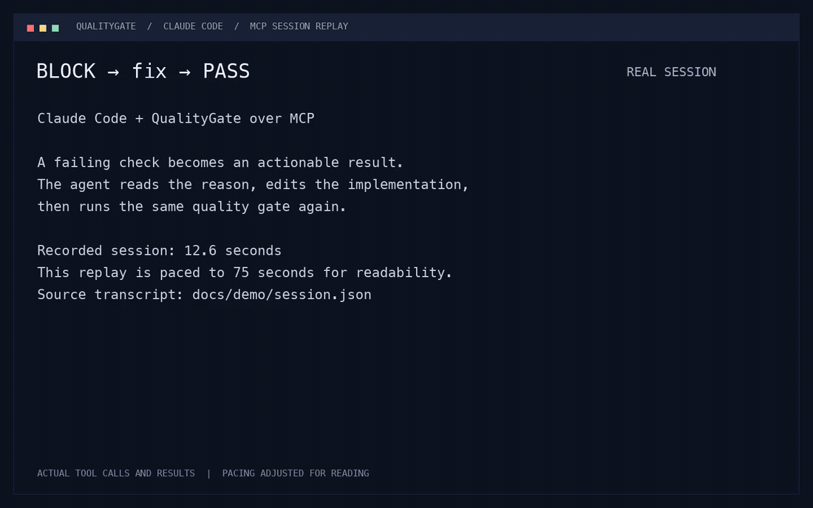

# QualityGate

QualityGate runs your project's checks and gives developers, CI and AI agents the
same PASS/BLOCK verdict, failure reasons and saved evidence through a CLI and MCP.



**[Watch the 75-second demo](docs/demo/qualitygate-claude-code.mp4)** ·
[Actual session transcript](docs/demo/session.json) · [Reproduce it](examples/agent-fix/)

Claude Code calls `run_gates`, reads the failing test output, fixes a sign error,
and calls the same MCP tool again. Tests and configuration stay unchanged. The GIF
and video replay a real Claude Code session with pauses paced for readability;
they are not a capture of the interactive Claude Code TUI.

[Vision](VISION.md) · [Contributing](CONTRIBUTING.md) · [Security](SECURITY.md) ·
[Verification](docs/VERIFICATION.md)

## Quickstart

Requires Node **22.19+** and **pnpm 11.5.1**. Chrome is only needed for URL audits;
set `CHROME_PATH` to select an executable when discovery fails.

```sh
git clone https://github.com/nikolai-tatianenko/lighthouse-nodejs-cicd.git
cd lighthouse-nodejs-cicd
corepack enable
pnpm install --frozen-lockfile
pnpm build
node dist/qualitygate.mjs run
```

The repository's `.qualitygate.yml` runs its lint, typecheck and test gates. Exit 0
means PASS. To use QualityGate on another project, create a config in that project:

```yaml
schemaVersion: 1
gates:
  - id: lint
    run: pnpm lint
  - id: test
    run: pnpm test
    timeoutMs: 300000
outputDir: .qualitygate
```

Run the built CLI with `--config /path/to/project/.qualitygate.yml`. Commands run in
the config file's directory. Run a subset with `--gate lint --gate test`, or use
`--json` for one machine-readable result on stdout.

**Gate commands are not sandboxed.** They run through the system shell with your
permissions and inherited environment. Review configuration before running checks,
including through MCP. See [SECURITY.md](SECURITY.md) for the execution boundary.

## Connect Claude Code through MCP

After building, add `.mcp.json` to the project you want to check. Use absolute paths
for the built CLI and that project's config:

```json
{
  "mcpServers": {
    "qualitygate": {
      "command": "node",
      "args": [
        "/absolute/path/to/qualitygate/dist/qualitygate.mjs",
        "mcp", "--config", "/absolute/path/to/project/.qualitygate.yml"
      ]
    }
  }
}
```

Ask Claude Code: **"Run QualityGate before editing. If it returns BLOCK, read the
failure, fix the implementation, then run it again. Keep tests and policy unchanged."**

| MCP tool | Result |
| --- | --- |
| `list_gates` | Configured gate IDs, commands, URLs and thresholds |
| `run_gates` | Run all gates or selected IDs; return verdict and failure output |
| `get_run` | Inspect a stored run by ID, or the latest run |

Tools accept no arbitrary command, path or URL: they use the selected configuration.
The configured commands and local plugins remain trusted code. The same run schema
and policy apply to CLI and MCP. Passing gate logs are omitted from MCP output;
failing gate output includes a bounded tail and a path to the full log.

## Lighthouse audits

Create a URL config without overwriting existing files:

```sh
node dist/qualitygate.mjs init https://example.com --config web-qualitygate.yml
node dist/qualitygate.mjs run --config web-qualitygate.yml
```

```yaml
schemaVersion: 1
urls:
  - http://127.0.0.1:4173
thresholds:
  performance: 80
  accessibility: 90
  seo: 90
  best-practices: 90
outputDir: .qualitygate
timeoutMs: 120000
```

Command gates and URL audits can share one config. Scores use 0–100 and each
category threshold is explicit. An absent required metric blocks the result.
URLs run sequentially; errors are retained per URL.

For a local example, keep `pnpm fixture` running in another terminal and point the
config at `http://127.0.0.1:4173`. Set all thresholds to zero for PASS. Set `seo: 100`
for BLOCK: the fixture deliberately omits a meta description. Zero thresholds are
for the demonstration; missing metrics still block. Policy evaluation is deterministic
for the same saved scores and thresholds; Lighthouse measurements can vary by run.

## How it differs from Lighthouse CI and SonarQube

| Tool | Primary role |
| --- | --- |
| [Lighthouse CI](https://github.com/GoogleChrome/lighthouse-ci/blob/main/docs/configuration.md) | Collect Lighthouse audits, assert budgets and thresholds, and upload reports in CI |
| [SonarQube](https://docs.sonarsource.com/sonarqube-server/quality-standards-administration/managing-quality-gates/introduction-to-quality-gates) | Analyze code and apply quality gates to analysis metrics such as reliability, security and coverage |
| QualityGate | Run existing project commands and Lighthouse locally; expose one stored verdict and actionable failure output to CLI, CI and MCP clients |

QualityGate focuses on the agent feedback loop: check, read the reason, fix, check
again. It can invoke existing analyzers through command gates. It does not implement
SonarQube's analyzers or Lighthouse CI's report-history service. Dedicated ESLint
and Vitest result adapters and richer inspection are planned in
[issue #1](https://github.com/nikolai-tatianenko/lighthouse-nodejs-cicd/issues/1) and
[issue #2](https://github.com/nikolai-tatianenko/lighthouse-nodejs-cicd/issues/2).

## Results, evidence and exit codes

Each run gets a unique ID and saves `.qualitygate/<runId>/report.json`. Raw Lighthouse
JSON and full command logs are stored beside it. Report paths resolve relative to
the config file. Ordinary output shows scores, errors and paths; `--json` emits a
versioned JSON result. Command log tails are limited to 4 KB in the report.

| Exit | Meaning |
| --- | --- |
| 0 | Completed, PASS |
| 1 | Completed, BLOCK |
| 2 | Configuration, browser, command execution, cleanup or storage error |
| 130 | SIGINT or SIGTERM interruption |

Execution status and policy decision are separate. Errors take precedence over
BLOCK, and failure on a later URL or gate preserves earlier results. Timeouts and
interruptions stop owned process groups and save a summary when storage is available.
Chrome startup settlement and cleanup can add roughly three seconds to an audit
timeout. When storage rejects writes, the returned result explicitly records the
error; a saved report cannot be guaranteed.

## Development and installation checks

```sh
pnpm check           # Lint, strict typecheck, tests and build
pnpm verify:clean    # Fresh install from the lockfile and all checks
pnpm smoke           # Real Chrome: PASS/BLOCK, errors, timeout and Ctrl+C
pnpm verify:package  # Local tarball install and real Chrome smoke
```

CI provisions Chrome, runs checks and uploads evidence from `.qualitygate/`.
The CLI is tested from a local tarball; this does not publish a package to npm:

```sh
npm pack
npm install --prefix /tmp/qualitygate-demo ./qualitygate-prototype-0.1.0.tgz
/tmp/qualitygate-demo/node_modules/.bin/qualitygate --help
```

Maintained source lives under `packages/`. The original service is archived in
[`legacy/lighthouse-v1/`](legacy/lighthouse-v1/) with separate dependencies and its
original ISC license. It is excluded from the workspace and CLI package.
QualityGate is licensed under [MIT](LICENSE). Dashboards, desktop and Ink are deferred.
