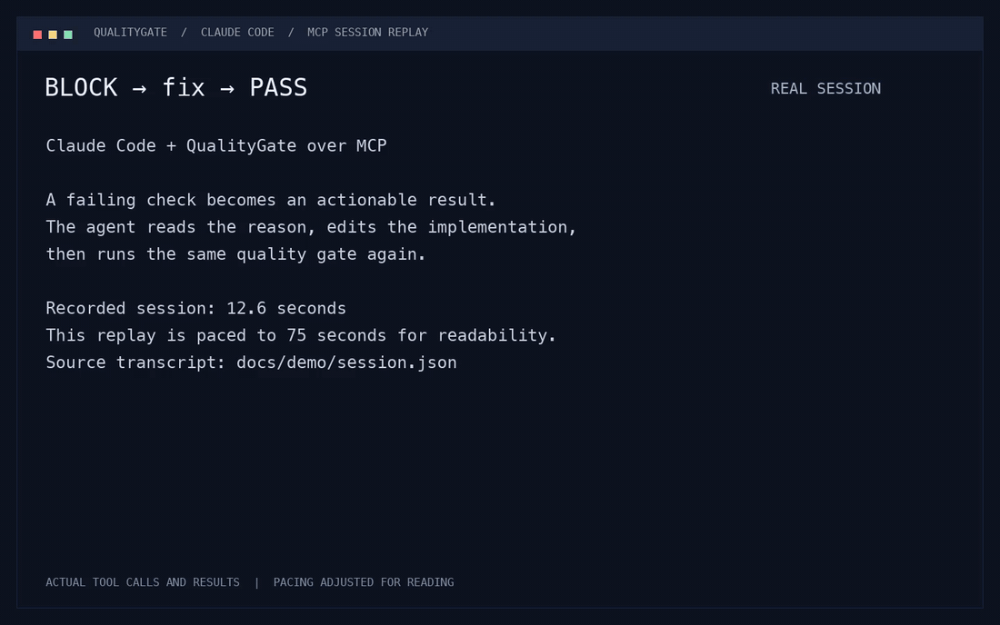
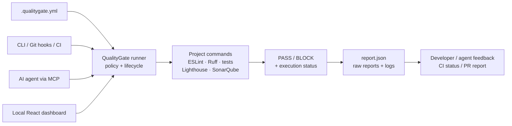
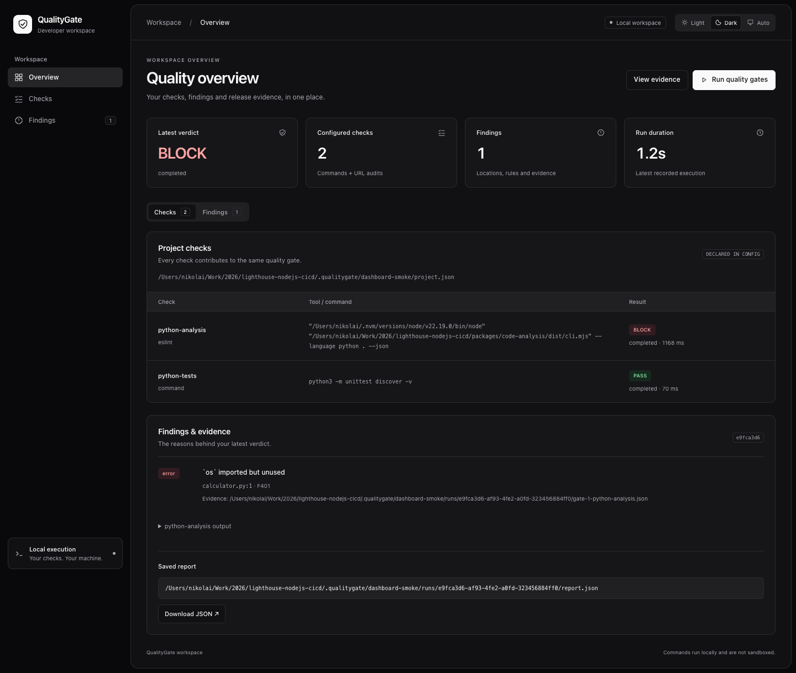
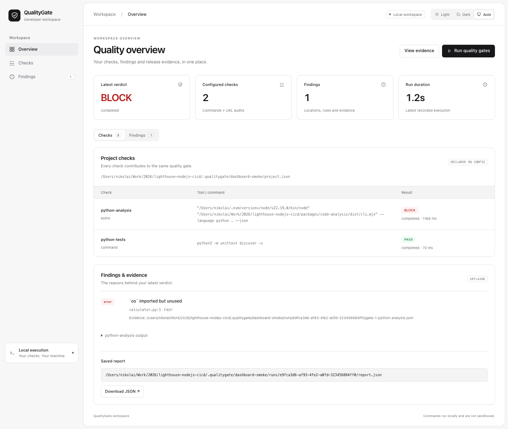
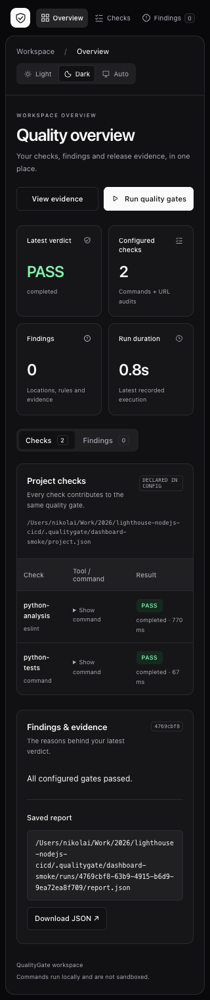

# QualityGate

QualityGate runs your project's existing checks and gives developers, CI and AI agents
one **PASS / BLOCK decision**, actionable findings and saved evidence.

**Local-first · CLI + MCP + React dashboard · TypeScript / JavaScript / Python · MIT**

[Quickstart](#try-it-locally) · [Install in your project](#add-to-an-existing-project) ·
[CI](#run-in-ci) · [Husky](#attach-to-git-with-husky) · [Agents](#connect-an-agent) ·
[Architecture](docs/ARCHITECTURE.md) · [Verification](docs/VERIFICATION.md)



**[Watch the 75-second demo](docs/demo/qualitygate-claude-code.mp4)** ·
[Real session transcript](docs/demo/session.json) · [Reproduce the agent loop](examples/agent-fix/)

A recorded Claude Code session, replayed with pauses for readability. The agent
uses QualityGate over MCP, fixes an implementation error and reruns the same checks;
tests and policy stay unchanged.

## Why QualityGate?

Lint, tests and scanners already do useful work. Their commands, thresholds,
exit codes and reports are often spread across scripts, CI jobs and agent prompts.
QualityGate puts the **decision and its evidence** behind one project-owned contract.

- **One configuration:** run the same declared checks locally, in hooks, in CI and through MCP.
- **A reason to act on:** file, line, rule and message when the tool provides structured output.
- **Evidence you can inspect:** keep raw reports and logs alongside the normalized run result.
- **Honest failures:** a failed tool, missing metric or failed report write cannot become a successful CI exit.

The feedback loop is simple: **check → read the cause → fix → check again**.
QualityGate is useful when that loop needs to work consistently across several tools
and interfaces. Your existing tools remain responsible for their own analyses.

## How it works



Checks run sequentially. Execution status and policy decision are separate; errors
have their own exit code and preserve earlier results. Interfaces share the runner
and run schema. See [package boundaries and lifecycle](docs/ARCHITECTURE.md).

## The dashboard

A local workspace for running/cancelling checks, inspecting findings and downloading
the run JSON. The neutral, shadcn-inspired interface supports **Light / Dark / Auto**,
saved browser preferences and mobile layouts.



<details>
<summary>Light theme and mobile screenshots</summary>





</details>

These are real Chrome captures of the local Python fixture. An unused import causes
BLOCK; removing it produces PASS. The overview cards show actual run data, not
synthetic charts. [Dashboard setup and verification](packages/dashboard/README.md).

## Try it locally

From a checkout of this source, use **Node 22.23.4+** and **pnpm 11.28.9**. The baseline
is pinned in [.nvmrc](.nvmrc) and [package.json](package.json).

```sh
nvm install
nvm use
corepack enable
pnpm install --frozen-lockfile
uv tool install ruff==0.9.2
pnpm build
pnpm dev:ui
```

Open **http://qualitygate.localhost:1355** and click **Run quality gates** to check
this repository's lint, types, complexity and test coverage. CLI equivalent:

```sh
node dist/qualitygate.mjs run
```

Ruff is needed for this repository's Python adapter/self-tests; another project's
command-only configuration does not require it. Use another Node manager or
[official Ruff installation method](https://docs.astral.sh/ruff/installation/) if
you do not use nvm/uv. Chrome is needed only for URL audits/browser verification.

The UI uses **Vercel Portless 0.12.0**, pinned for Node 22 compatibility. Its proxy
and backend bind to loopback, with a stable named URL and an automatically allocated
backend port. No certificate installation or hosts-file edits are performed.
If port 1355 is occupied, use `PORTLESS_PORT=1356 pnpm dev:ui`. Direct fallback:

```sh
pnpm dashboard --port 4173
# http://127.0.0.1:4173
```

[Portless details, supported arguments and shutdown behavior](docs/PROJECT_SETUP.md#5-open-this-projects-local-dashboard).

## Add to an existing project

The CLI is **not published to npm yet**. Build a local tarball in the QualityGate checkout:

```sh
pnpm pack:local
```

It builds, packs into a versioned folder (`.packages/<version>/`, so two versions or checkouts never
overwrite each other) and writes a `.sha256` file next to the tarball. Then, in the project you want to check:

```sh
mkdir -p tools
cp .packages/0.1.0/qualitygate-toolbox-0.1.0.tgz .packages/0.1.0/qualitygate-toolbox-0.1.0.tgz.sha256 tools/
(cd tools && shasum -a 256 -c qualitygate-toolbox-0.1.0.tgz.sha256)
pnpm add -D ./tools/qualitygate-toolbox-0.1.0.tgz
```

Keep the archive repository-relative so CI can install it. Commit it with the target
manifest/lockfile. Create `.qualitygate.yml` using your project's **actual scripts**:

```yaml
schemaVersion: 1
gates:
  - id: lint
    run: pnpm run lint
  - id: typecheck
    run: pnpm run typecheck
  - id: tests
    run: pnpm run test:ci
    timeoutMs: 300000
outputDir: .qualitygate
```

A command gate can also read a test report into findings (file, line, message) and keep files
such as screenshots and traces as run evidence. The exit code still decides PASS/BLOCK; a report
never turns a non-zero exit into PASS. Formats: `junit`, `nunit`, `playwright-json`, `eslint-json`,
`axe-json`, `npm-audit`, `osv-scanner`, `gitleaks`,
`unity-log`:

```yaml
gates:
  - id: e2e                      # Playwright
    run: pnpm exec playwright test --reporter=json > playwright-report.json
    report: { format: playwright-json, path: playwright-report.json }
    artifacts: [test-results/**/*.png, test-results/**/trace.zip]
  - id: pytest                   # pytest
    run: pytest --junitxml=pytest.xml
    report: { format: junit, path: pytest.xml }
  - id: maestro                  # Maestro
    run: maestro test --format junit --output maestro.xml flows/
    report: { format: junit, path: maestro.xml }
  - id: unity-editmode           # Unity EditMode tests
    run: "$UNITY -batchmode -runTests -testPlatform EditMode -testResults results.xml -logFile unity.log"
    report: { format: nunit, path: results.xml }
```

Or let QualityGate write that file. `setup` asks every built-in ecosystem plugin what it finds and
merges the proposals: **node** (`lint`, `typecheck` / `type-check`, `test:ci` / `test` scripts, with
pnpm/yarn/npm from `packageManager` or the lockfile), **python** (`ruff check .`,
`pytest --junitxml`, `mypy .` when the project mentions it), **unity** (`unity-compile` and
`unity-tests` through Unity batch mode; macOS Hub path, `UNITY` overrides the editor), **playwright**
(JSON report plus screenshots, videos and traces as evidence) and **maestro**
(`maestro test --format junit`). When two ecosystems propose the same gate id, both are prefixed
(`node-tests`, `playwright-tests`). It also adds the output folders to `.gitignore` and never
overwrites an existing config:

**Monorepos and large projects.** The node ecosystem also reads `pnpm-workspace.yaml` / `workspaces` and proposes
`pnpm -r --if-present run <script>` (or `npm run <script> --workspaces --if-present`) when only the packages define a script,
a `vitest*.config` file when there is no test script, and every other `test:*` script. Anything slow, or needing a
browser or an emulator (`test:e2e`, `test:ios`, Maestro flows in `.maestro/`, `maestro/` or `flows/`), is listed as **found but not
enabled** with the reason, written as a commented block at the end of `.qualitygate.yml`; copy it under `gates:` to
enable it. A project with more than 300 test files gets a 30 minute timeout and a warning to use a faster subset
(`--changed` with `inputs`). Plain `eslint`, `vitest` and `node --test` scripts are rewritten with a JSON/JUnit report
(`.qualitygate/node/`) so findings arrive with file and line instead of a log; scripts with shell operators are left alone. When a lockfile is present, a dependency audit (`npm audit`, or `osv-scanner` for pnpm and yarn) is also listed as found but not enabled, because it needs the network and blocks on any known advisory.

**One list of gates.** If the project already declares its gates, `qualitygate setup --from gates.json` (or an ES module
exporting `gates`; a module is imported, so it runs with your permissions) reads them instead of detecting ecosystems:
`[{ "id": "lint", "run": "pnpm lint" }]`, `{ "gates": [...] }` or `{ "lint": "pnpm lint" }`; `name` and `command` are accepted for
`id` and `run`. `setup` lists the files it changed; `--no-gitignore` leaves `.gitignore` alone.

Third-party ecosystems, parsers and gates come from npm packages: `qualitygate setup --plugin <package>`
(repeatable) loads them from the project's `node_modules` and writes a `plugins:` list. **Plugins are
not sandboxed: they run inside QualityGate with your permissions**, so install only packages you
trust (see [Third-party plugins](docs/PROJECT_SETUP.md#third-party-plugins) and [SECURITY.md](SECURITY.md)).

```sh
pnpm exec qualitygate setup
# without installing first, from a tarball:
npx -p ./tools/qualitygate-toolbox-0.1.0.tgz qualitygate setup
```

Use a terminating test command rather than watch mode. Add `.qualitygate/` and
`.qualitygate-ci/` to `.gitignore`, then run:

```sh
pnpm exec qualitygate run
pnpm exec qualitygate run --gate lint --gate typecheck
pnpm exec qualitygate run --json
```

Commands resolve relative to the config file. The packaged CLI does not impose
this source checkout's package manager on consumers. To view another project,
run this from the QualityGate checkout:

```sh
pnpm dev:ui --config /absolute/path/to/project/.qualitygate.yml
```

The dashboard runs from this monorepo; the CLI tarball does not include its server/assets.
[Complete installation guide](docs/PROJECT_SETUP.md) · [Python project example](examples/python-project/).

## Run in CI

**Yes: run the CLI as a normal CI check.** The dashboard and Portless are local
interfaces; no dashboard server is needed to enforce gates in CI.

```sh
HUSKY=0 pnpm install --frozen-lockfile
pnpm exec qualitygate run --json
```

| Platform | Copyable template | Reporting |
| --- | --- | --- |
| GitHub Actions | [Workflow](examples/ci/github-actions.yml) | JSON/evidence artifacts, job summary, separate trusted PR publisher |
| GitLab CI | [Pipeline](examples/ci/gitlab-ci.yml) | JSON/Markdown/evidence artifacts; configure a trusted MR publisher separately |
| Bitbucket Cloud | [Pipeline](examples/ci/bitbucket-pipelines.yml) | JSON/Markdown/evidence artifacts; configure a trusted PR publisher separately |

The templates preserve the gate exit code while saving failure evidence. The report
includes decisions, timings, findings and bounded command output. The PR/MR adapter
preserves handwritten text and replaces only its marked automatic section on reruns;
it checks the current source SHA and skips older runs for that head.

API writes require an explicit `--write` command in a trusted publisher. Keep its
credentials out of target-code jobs. Live provider setup and concurrency limits are
explained in [CI and PR/MR reporting](docs/CI.md). Commit status, a sticky PR comment and Slack
notifications (BLOCK/error only) are covered there too. Browser smoke tests can run in CI;
that is different from deploying the local dashboard as a public service.

**Share a run.** `qualitygate export --out report/` writes the last run (or `--input run.json`)
as `index.html` + `report.json`: one self-contained page with inline CSS, no scripts and no network
resources, ready to upload as a Pages/S3/CI artifact. It contains command output and file paths, so
publish it only where the project's logs may be read. For a live view,
`pnpm dashboard --tunnel cloudflare|ngrok` shares a **read-only**, token-protected dashboard through
your installed tunnel tool ([details](packages/dashboard/README.md#share-through-a-tunnel-read-only)).

## Attach to Git with Husky

**Yes: Husky can invoke QualityGate before commits and pushes.** Install Husky in
the target project, then add the gate commands to its hooks:

```sh
pnpm add -D husky@9.1.7
pnpm exec husky init
```

For `.husky/pre-commit`:

```sh
pnpm exec qualitygate run --gate lint --gate typecheck
```

For `.husky/pre-push`:

```sh
pnpm exec qualitygate run
```

Preserve existing hook/prepare-script work when integrating. These commands check
the **working tree**, including unstaged changes. A nonzero result blocks the Git
operation. Hooks are bypassable; CI remains the independent enforcement point.
Set `HUSKY=0` during CI installation and use non-watch test commands.

[Copyable hook files](examples/hooks/README.md) · [Safe setup and troubleshooting](docs/PROJECT_SETUP.md#3-attach-husky-hooks).

## Connect an agent

From a target project with the CLI installed:

```sh
pnpm exec qualitygate connect --client claude --config .qualitygate.yml
```

Merge the printed configuration into the client's settings. The command does not
overwrite them. The client launches a **stdio MCP** process; the dashboard URL is
not an MCP endpoint. Claude Code, Cursor, Codex, VS Code and generic config formats
are supported. [Client setup and local-model adapters](docs/INTEGRATIONS.md).

| MCP tool | Purpose |
| --- | --- |
| `list_gates` | Read configured gate IDs, commands, URLs and thresholds |
| `run_gates` | Run all or selected gates and return the actual verdict/findings |
| `get_run` | Inspect a saved run or the latest result |
| `get_review_methodology` | Read a configured methodology at its pinned Git commit |

Ask the editor agent: **"Run QualityGate. If it blocks, read the findings, fix the
implementation, and run it again. Keep tests and policy unchanged."**

MCP only exposes the selected project configuration. The bounded `ask` model adapter
can inspect/run gates, but has no editing or shell tools; source fixes belong to the
editor agent. Live-model/editor verification limits are listed below.

## Checks you can combine

| Input | What QualityGate records |
| --- | --- |
| Existing project commands | Exit code, timeout/execution status and command logs |
| ESLint JSON | File, line, rule, severity and message, with raw report evidence |
| TS/JS analysis | ESLint/SonarJS complexity and code smells through the reusable analyzer |
| Python analysis/tests | Ruff findings and your declared Python test commands |
| Lighthouse | Performance, accessibility, SEO and best-practices scores on a 0–100 scale |
| axe-core JSON | Report parser, not an accessibility preset: one finding per violating element (`violations` only, not `incomplete`) with rule, impact and the selector from the page; `qualitygate report --sarif` exports a run as SARIF 2.1.0 |
| SonarQube | The quality gate for the specific scanner analysis, not an old project result |
| Agent review producer | Normalized confirmed/unresolved/rejected findings with methodology provenance |

For URL audits, `qualitygate init <URL> --config web-qualitygate.yml` creates explicit
thresholds without overwriting a file. Missing required metrics block the result.
Start the target app separately before auditing its URL. Command gates and audits
can share a configuration.

For external review methodologies, `sources sync` explicitly updates the lock,
`sources restore` fetches frozen revisions, and `get_review_methodology` reads
local pinned content. Loading Cloudflare's skill
is not a completed audit: a capable review producer and the methodology's required
isolation/verification are separate work. See [SonarQube and security review](docs/SECURITY_REVIEW.md).

[Standalone analyzer](packages/code-analysis/README.md) · [Project-specific rule overrides](docs/CODE_QUALITY.md).

## Results and exit codes

A run saves `.qualitygate/<run-id>/report.json`, raw audit/JSON reports and command
logs. CLI text is readable; `--json` is machine-readable. Reports retain earlier
results when a later check fails. Saving a report is atomic; storage failure remains
an error and cannot guarantee a saved artifact.

| Exit | Meaning |
| --- | --- |
| `0` | Completed, PASS |
| `1` | Completed, BLOCK |
| `2` | Configuration, execution, cleanup or storage error |
| `3` | A gate timed out (nothing else went wrong). Reported as `TIMEOUT`, not as a tool error |
| `130` | Interrupted |

Execution errors take precedence over a timeout, and a timeout over a policy BLOCK. A gate that times out keeps the
partial test counts its report showed ("timed out after 300000ms: passed 40, failed 0, stopped by timeout").

Every run records a **step registry** (`steps` in `report.json`, the Markdown/HTML report and the terminal): each
configured gate and URL is `passed`, `failed`, `timeout`, `error`, `interrupted`, `skipped`, `cached` or
`not-run`. A PASS built from 3 of 30 gates says "3 of 30 steps ran". Independent gates run in parallel
(`concurrency: 4` by default, `1` for strictly sequential runs); `dependsOn: [gate-id]` orders them and skips a
gate whose dependency did not pass. URL audits run after the gates, one at a time; cancellation stops owned
processes. [Lifecycle details](docs/ARCHITECTURE.md).

Fast local runs: `qualitygate run --only <gate>` (alias of `--gate`), `--changed` (a gate with `inputs: [globs]` runs only
when a changed file matches; gates without `inputs` always run) and `--cache` (a gate whose `inputs` are unchanged since it
last passed is reported as `cached`). The terminal shows one line per gate with the path to its log; npm and pnpm
warnings stay in the log.

Live progress: in an interactive terminal `qualitygate run` redraws one row per gate in place (waiting, running with elapsed
seconds and the last output line of the gate, then PASS/BLOCK), clears the rows when the run ends and prints a one-line
summary before the usual text. It is used only when stdout is a TTY, `CI` is not set, `TERM` is not `dumb` and the output is
not `--json`; `--no-live` or `QUALITYGATE_NO_LIVE=1` turns it off. Piped output, CI output, `--json` and exit codes are
identical with and without it. Escape sequences in gate output are stripped before display, and the output of a gate whose
report parser handles secrets (such as `gitleaks`) is not shown live. Ctrl+C still cancels the gates (exit 130) and restores
the cursor. It uses plain ANSI escape codes rather than React Ink, which would add React 19.3 and about twenty runtime packages
to a CLI that bundles with `packages: external`; the view shows the newest line only, not a scrolling log window.

### Run history and trends

Every `run` (CLI, dashboard and MCP) also appends the finished run to a local SQLite database,
`<outputDir>/history.sqlite` (default `.qualitygate/history.sqlite`), through Node's built-in `node:sqlite`
(no dependency; Node 22 prints an "experimental" warning for it, which QualityGate suppresses). Each run stores its id,
times, decision, execution, duration and, per gate, the status, duration and, for gates that declare `inputs`, the hash of
their input files. Nothing is uploaded and old runs are not pruned; delete the file to start over.

```sh
qualitygate history [--limit 10] [--json]   # recent runs: id, time, decision, duration, gate counts, then a comparison
qualitygate trends  [--limit 50] [--json]   # blocks per week, most frequently failing gates, flaky gates
```

`history` compares the newest run with the one before it: a **regression** is a gate that passed before and blocks now
(`failed`, `timeout` or `error`), a **new failure** is any gate that blocks now and did not block before (a new gate
included), **fixed** gates blocked before and pass now, and **newly slow** gates took at least twice as long and at least
one second longer. Skipped and interrupted gates are not compared. Both commands exit `0` even when they report a
regression; they never gate anything. A **flaky** gate flips between PASS and BLOCK at least twice within the last `--limit`
runs without a change of its inputs hash (when no hash exists, because the gate declares no `inputs`, a flip cannot be
explained and counts). `qualitygate export` adds the same trends to the static HTML report when history exists (last 50 runs).

History never changes a verdict: if the database cannot be written, `run` prints `warning: run history not saved (...)` to
stderr and keeps its result and exit code. A corrupt database does not break `run`; `history` and `trends` report it as an
error (exit `2`) and `export` omits the trends with a warning. History is a local file, so it only reflects runs made on
this machine and is not shared between CI jobs.

## How it fits alongside existing tools

| Tool | Main role |
| --- | --- |
| [Lighthouse CI](https://github.com/GoogleChrome/lighthouse-ci/blob/main/docs/configuration.md) | Lighthouse collection, assertions, report upload/history |
| [SonarQube](https://docs.sonarsource.com/sonarqube-server/quality-standards-administration/managing-quality-gates/introduction-to-quality-gates) | Code analysis and quality gates for its analysis metrics |
| QualityGate | Orchestration and a shared verdict/evidence contract across existing tools, local workflows, CI and agents |

QualityGate complements these tools. It does not reproduce SonarQube's analysis
platform or Lighthouse CI's history service. Its focus is making a project's existing
quality policy available to people and agents through the same execution path.

## Technology stack

| Area | Technology | Purpose |
| --- | --- | --- |
| Runtime | Node.js 22.23.4 baseline | CLI, service, MCP and dashboard backend |
| Language | TypeScript 5.9.3 | Strict contracts and implementation |
| Workspace | pnpm 11.28.9 | Monorepo, frozen installs and dependency policy |
| Frontend | React / React DOM 19.2.0, CSS/SVG | Local dashboard with semantic theme tokens |
| Local routing | Vercel Portless 0.12.0 | Named `.localhost` URL, loopback proxy |
| Build | esbuild 0.25.10, tsx 4.20.6 | Bundles and source execution |
| Validation | Zod 3.25.76, YAML 2.8.1 | Versioned config/results |
| TS/JS analysis | ESLint 9.37.0, typescript-eslint 8.46.1, SonarJS 4.2.2 | Lint, complexity and code smells |
| Python | External Ruff 0.9.2 and project test commands | Python analysis and checks |
| Browser audits | Lighthouse 13.5.0, chrome-launcher 1.0.0 | Real Chrome audits |
| Agent protocol | MCP SDK 1.32.1 | Stdio tool interface |
| Models | Ollama / vLLM / compatible HTTP adapters | Bounded tool calling; live inference experimental |
| Tests | node:test, jsdom 26.1.0, React act | Unit/integration/UI behavior |
| Coverage | c8 10.1.3 / V8 | Enforced runtime coverage, HTML/JSON/LCOV |
| Browser verification | Puppeteer Core 24.43.1 + Chrome | Real UI and execution workflows |
| Git hooks | Optional target-project Husky 9.1.7 | Pre-commit / pre-push integration |
| CI | GitHub Actions / GitLab CI / Bitbucket Pipelines templates | Native gate exits and report artifacts |
| Evidence | Filesystem + JSON | Per-run reports, logs and raw tool output |

Source installs enforce pinned pnpm and a **seven-day minimum registry release age**,
without age exclusions. These are supply-chain controls, not a malware scan.
[Toolchain setup](CONTRIBUTING.md) · [Workspace](pnpm-workspace.yaml) · [Lockfile](pnpm-lock.yaml).

## Verification and current limits

**Working developer preview.** Verification is local evidence, not a claim that every
provider, OS or deployment has been tested.

| Area | Evidence / boundary |
| --- | --- |
| CLI and packaging | Local tarball installation and exit-contract tests |
| Browser execution | Real Chrome PASS/BLOCK, timeout, cancellation and cleanup checks |
| Dashboard | Light/dark/system behavior, mobile layouts and selected contrast checks in Chrome |
| Portless | Named-origin HTTP routing, CSRF checks, real browser execution and proxy shutdown |
| Git hooks | Real Husky in a disposable Git fixture; blocked/passing commits and local dry-run pushes |
| Agents | Recorded Claude Code demo; generated configs and model adapters have contract tests |
| Still unverified | Live Cursor/Codex sessions, live Ollama/vLLM inference, live SonarQube and all provider deployments |
| Real-project trial | One pnpm monorepo with Node, Vitest and Playwright: setup found its gates, parallel runs, timeout exit code `3` and the step registry worked; truncated `node --test` reports in long runs are still being investigated |
| Still to build | Complete Cloudflare audit harness/sandbox, exact source-tree binding, a history UI in the dashboard, plugin isolation and signing, Tauri desktop and Chrome extension clients |

The repository checks itself with the same gate configuration. Runtime coverage
includes the CLI, core, plugins, services, adapters and dashboard TS/TSX; the only
explicit exclusion is the interfaces-only SDK file. CSS/layout are verified in the
browser, outside V8 coverage. No native Windows support claim is made.

```sh
pnpm check                    # Lint, types, complexity, enforced coverage and build
pnpm verify:ci-templates      # YAML + exit/status/publication-boundary checks
pnpm smoke:dashboard          # Real React/Python BLOCK → fix → PASS + theme checks
pnpm smoke:portless           # Named URL + real Chrome + strict origin checks
pnpm verify:hooks             # Real Husky fixtures; no changes to your checkout's hooks
pnpm smoke                    # Real Lighthouse/Chrome lifecycle scenarios
pnpm verify:package           # Local CLI tarball install + browser smoke
pnpm verify:analysis-package  # Independent analyzer tarball
```

[Verification records](docs/VERIFICATION.md) · [Environment matrix](docs/ENVIRONMENTS.md) ·
[Roadmap](TODO.md) · [Detailed roadmap and status](docs/QUALITYGATE_DETAILED_ROADMAP.md) · [Product vision](VISION.md).

## Security, contribution and license

**Gate commands are trusted code and are not sandboxed.** They inherit local
permissions and environment. The dashboard has no authentication and is intended
for loopback access; do not expose it as a public service. Raw evidence may contain
project data. [Execution boundary and private reporting](SECURITY.md).

Contributions should preserve explicit policy, versioned results, visible errors
and cleanup guarantees. [Contributing](CONTRIBUTING.md).

QualityGate is [MIT licensed](LICENSE). The original ISC-licensed service was removed from
the tree; it remains available in git history before the removal commit.

### Attribution

Copyright (c) 2026 Nikolai Tatianenko. The MIT license requires keeping this copyright
notice and the [LICENSE](LICENSE) text in every copy or substantial portion of the software,
including redistributed builds and forks. If you build on QualityGate, please also credit
the author and link to <https://github.com/nikolai-tatianenko/quality-gates>.
