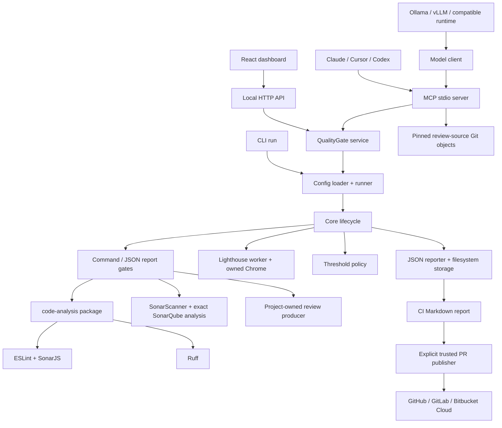

# Current package boundaries

- **protocol / plugin-sdk:** versioned Zod data and TypeScript plugin contracts.
- **core / policy:** sequential execution, cleanup stack, partial results and
  deterministic decisions. Execution error and quality BLOCK remain distinct.
- **plugins:** trusted tool execution, report parsing and durable evidence.
- **review-sources:** inert Git downloads, explicit updates and frozen restore;
  pinned methodology reads for MCP. Review execution remains a configured producer.
- **live view:** `core` emits display-only progress events (`plan`, `start`, `log`, `end`) through `RunOptions.onProgress`;
  `cli/src/live.ts` draws them with plain ANSI codes only on a TTY outside CI. It never changes results, output or exit codes.
- **history:** `core/src/history.ts` appends each finished run to `<outputDir>/history.sqlite`
  (`node:sqlite`) and derives comparisons and trends; the CLI `history`/`trends` commands and the exported HTML
  report read it. A write failure is a stderr warning and never changes the verdict or exit code.
- **ci:** bounded Markdown rendering, manual/automatic description sections and
  explicit provider writes. Publication is separate from gates and MCP.
- **service:** shared list/run/inspect behavior; one active mutation per instance,
  cancellation and disconnect drain. CLI calls the runner directly.
- **code-analysis:** independently installable API/CLI; fixed TS/JS and Python
  analysis policy. It needs no QualityGate core to scan another project. A gate
  wraps its ESLint-compatible output to attach run IDs and evidence paths.
- **dashboard:** React renders server results. The loopback HTTP server fixes the
  project config at startup and delegates runs to the same service as MCP.
- **integrations / model-client:** client configuration emitters and bounded
  tool-calling adapters; model prose cannot override a validated gate verdict.

The repository's `.qualitygate.yml` invokes lint, typecheck, the analysis package
and coverage tests. `verify:project` adds a local documentation URL to that same
policy for a complete command-gates + Lighthouse self-check.

There is no remote account, upload service, untrusted plugin sandbox or global
cross-process scheduling lock. Each run owns its processes and UUID evidence
directory. Commands remain trusted local code; see [SECURITY](../SECURITY.md).
